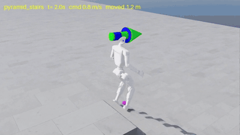

# WYS: "Watch Your Step" training and evaluation notes

A personal run of the code for **Watch Your Step: Anticipated Perception for Humanoid Locomotion**
(Heyrman, Li, Dadiotis, Hutter; ETH Zurich). This is **not** an official repository and
**not a reproduction of the paper's results**.

- Project page: https://leggedrobotics.github.io/watch-your-step/
- Paper: https://arxiv.org/abs/2610.29612

The original training code is not included here. Get it through the project page.

## Demo

Preview: 1.5 s (from t = 2.0 s) of each of the 13 clips. Click it to open the
[full video](videos/all_terrains.mp4) (about 130 s, 23 MB; download it if GitHub does not play it).
These are single episodes from a centre spawn, not a success rate; see [Videos](#videos).

## Setup of this run

| | This run | Repository default |
|---|---|---|
| Iterations | 15,000 | 40,000 |
| Training environments | 4,096 | 8,192 |
| Seeds | 1 (seed 1) | - |

GPU: NVIDIA GeForce RTX 5070 Ti Laptop GPU, 12 GB. Training took 11 h 33 min (about 2.66 s per iteration, about 9.2 GB VRAM).
`agent.save_interval=500` was set from the command line.

## Locomotion evaluation (`model_14999.pt`)

3,328 evaluation environments (default: 10,400), terrain difficulty 0.5, no pushes, no policy observation noise.
"Tracking" is the mean fraction of the commanded distance covered in 10 s, not a binary success rate.
The reference is the pretrained `demo/model_10000.pt` of the original code under the same settings.
The original script drops falls that happen before 3 s. "Falls incl." counts them too.
Tracking also excludes those episodes.

| Terrain | Set | Tracking % | Reference tracking % | Falls % (original) | Falls % incl. |
|---|---|---|---|---|---|
| pyramid_stairs | train | 71.1 | 71.5 | 0.4 | 0.4 |
| pyramid_stairs_inv | train | 80.6 | 76.7 | 0.4 | 47.5 |
| boxes | train | 75.8 | 76.4 | 0.0 | 0.0 |
| random_rough | train | 78.1 | 78.2 | 0.0 | 0.0 |
| hf_pyramid_slope | train | 78.6 | 78.6 | 0.0 | 0.0 |
| hf_pyramid_slope_inv | train | 76.0 | 76.1 | 0.0 | 0.0 |
| stepping_stones | train | 68.0 | 69.7 | 0.6 | 3.5 |
| pallets | unseen | 69.7 | 72.2 | 1.1 | 37.5 |
| wave | unseen | 78.1 | 79.6 | 0.0 | 0.0 |
| discrete_obstacles | unseen | 79.0 | 77.3 | 0.0 | 0.0 |
| random_uniform | unseen | 76.9 | 77.5 | 2.4 | 3.0 |
| concentric_gaps | unseen | 61.7 | 66.2 | 1.2 | 6.2 |
| flat | flat | 78.6 | 77.8 | 0.0 | 0.0 |
| **all** | | **74.8** | **75.2** | **0.5** | **10.9** (reference: 10.4) |

### About the early falls
- **Inverted stairs:** in a separate diagnostic run, all 419 early falls started more than 1.0 m from the centre
  in x or y, outside the flat platform. Spawning on the steps is the likely cause.
- **Pallets:** early falls were about 4% for spawns within 0.8 m of the centre and about 40% outside it.
  The overlap with the terrain geometry was not checked.
- Stairs cover only the central part (about 6 x 6 m) of the tile, so stair tracking includes flat walking.

Corridor and foothold-prediction evaluations were not run. No comparison with the paper's numbers was made.

## Videos
`videos/all_terrains.mp4` and one clip per terrain. Each is a single episode: centre spawn, same heading,
0.8 m/s forward command, 10 s. All 13 finished without a fall. They illustrate the gait and are not a success rate.
Magenta spheres are the footholds predicted by the FPM.

## Files
- `models/`: policy `model_14999.pt` and its foothold model `foot_model_14505.pt`. Keep both in one directory.
- `scripts/validate_locomotion_early.py`: the original evaluation script plus early-fall counts.
- `scripts/spawn_check.py`: the above plus fall time and spawn offset diagnostics (needs `SPAWN_OUT=<file>`).
- `scripts/record_terrains.py`: per-terrain video recording.
- `scripts/train_long.sh`, `scripts/report.py`: training launcher and progress report. Paths assume a local
  layout with the original code in `src/` and a virtual environment in `.venv/`.

To run the evaluation scripts, add the original code's `scripts/` directory to `PYTHONPATH`.

## License and attribution
The evaluation scripts are modified from, or reuse parts of, the original code, which is
(c) 2026 ETH Zurich under the MIT License: see `licenses/LICENSE-watch-your-step`.
The models were trained with that code and the Unitree G1 model it includes.
